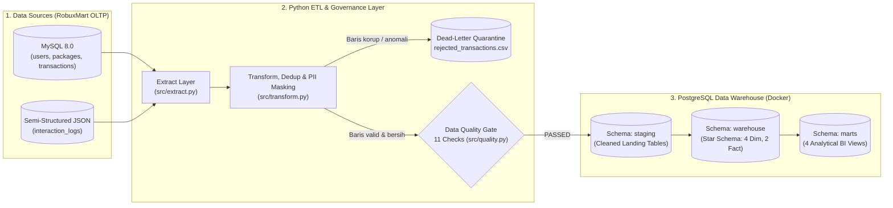
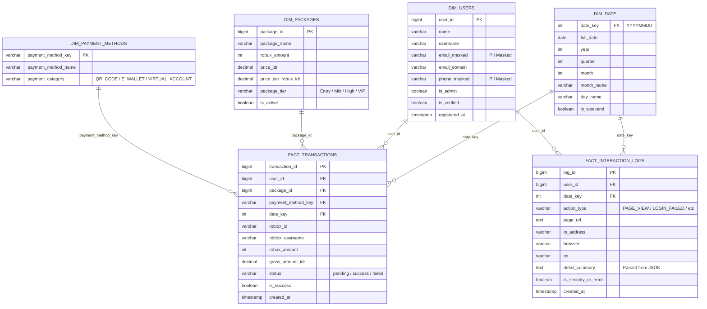
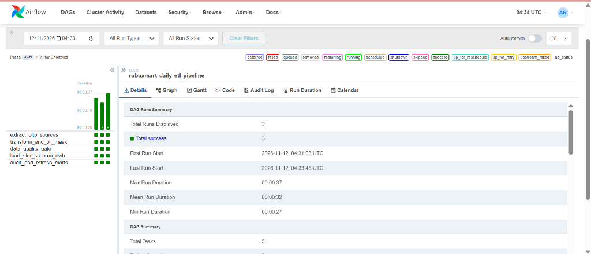
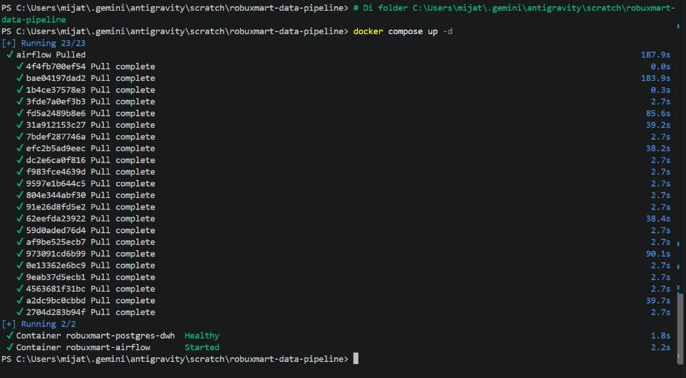
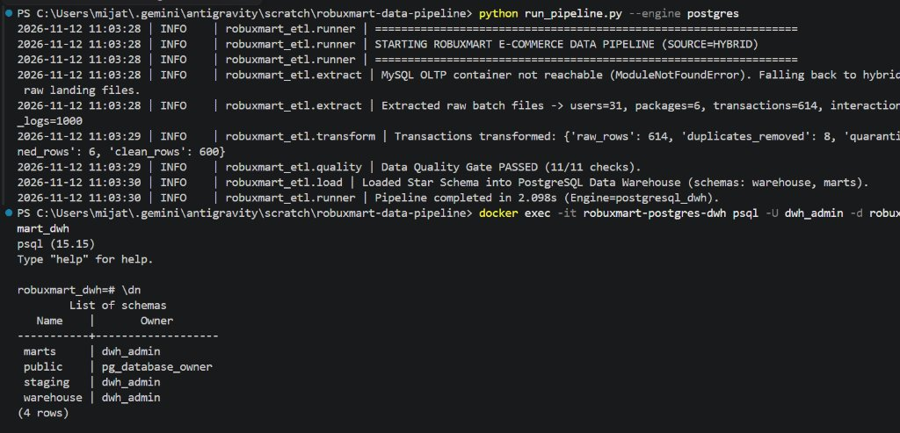
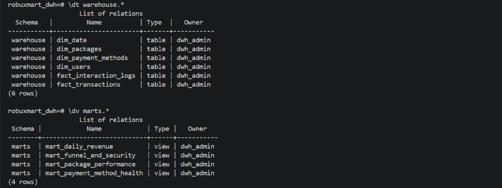
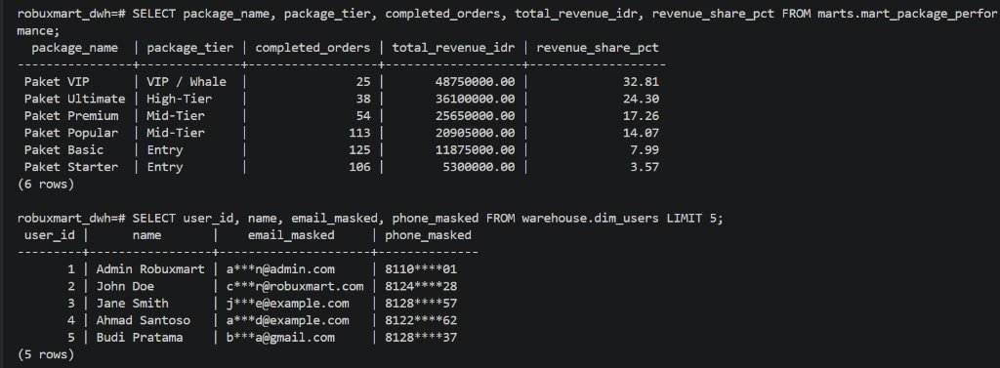
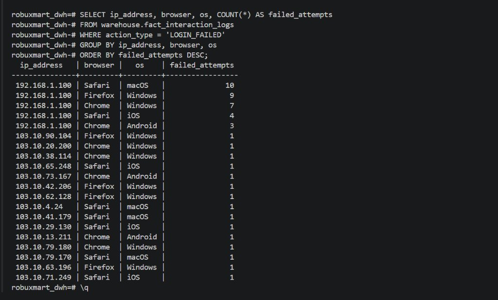

# RobuxMart End-to-End E-Commerce Data Pipeline & Star Schema Warehouse

> **Portofolio Data Engineering (Tahap 1 — Batch ETL, Data Quality Gate, PII Governance & Dimensional Data Warehouse)**  
> Mengolah data transaksi pembelian Robux dan log aktivitas semi-terstruktur (JSON) dari aplikasi marketplace **RobuxMart (MySQL OLTP)** menuju **PostgreSQL Data Warehouse (OLAP)** dengan pemodelan **Star Schema**.

---

## 1. Latar Belakang Masalah & Solusi

Pada aplikasi transaksi **RobuxMart** (Laravel + MySQL 8.0), seluruh operasional berjalan di database transaksional (**OLTP**):
1. **Beban Query Analitik:** Menjalankan query agregasi pendapatan harian, analisis *lifetime value* pelanggan, dan parsing JSON `interaction_logs` langsung di MySQL produksi berisiko memperlambat proses *checkout* pelanggan.
2. **Masalah Kualitas Data (Data Quality Issues):** Callback/webhook dari *payment gateway* terkadang mengirim data ganda (*duplicate retries*), format nama metode pembayaran tidak konsisten (`" qris "`, `"gopay"`), serta potensi anomali transaksi (harga $\le 0$ atau `roblox_id` kosong).
3. **Keamanan Data Pribadi (PII Governance):** Tabel `users` menyimpan hash `password`, `email`, dan nomor telepon (`phone`) yang tidak boleh terekspos mentah ke tim analis/BI di Data Warehouse.

### Solusi Data Engineering yang Dibangun:
- **Hybrid Data Ingestion (`src/extract.py`):** Mengekstrak 4 entitas utama RobuxMart (`users`, `packages`, `transactions`, `interaction_logs`) dari database MySQL OLTP maupun *raw batch landing files* (`CSV` & `JSON`).
- **Idempotent Transformation & Dead-Letter Quarantine (`src/transform.py`):**
  - Menghapus duplikasi transaksi akibat *webhook retry*.
  - Melakukan **PII Masking** (`customer@robuxmart.com` $\rightarrow$ `c***r@robuxmart.com`, `081234567890` $\rightarrow$ `0812****90`) dan membuang kolom sensitif `password`.
  - Mem-parsing kolom **JSON** `details` dan `user_agent` (Browser & OS) pada `interaction_logs`.
  - Memisahkan baris transaksi yang rusak/anomali ke **Dead-Letter Quarantine** (`data/quarantine/rejected_transactions.csv`) lengkap dengan kode alasan penolakan (`rejection_reason`).
- **Automated Data Quality Gate (`src/quality.py`):** Menjalankan 11 pemeriksaan otomatis (keunikan Primary Key, *Referential Integrity* Foreign Key, validasi enum status, kepatuhan PII, dan batas nilai transaksi) sebelum data diizinkan masuk ke Data Warehouse.
- **Dimensional Data Warehouse (`sql/` & `src/load.py`):** Menyimpan data bersih ke dalam arsitektur **Star Schema** (`warehouse.dim_*` & `warehouse.fact_*`) serta menyediakan 4 **Data Marts** (`marts.mart_*`) siap pakai untuk kebutuhan Business Intelligence dan deteksi anomali keamanan (DevSecOps).

---

## 2. Arsitektur Data Pipeline



---

## 3. Desain Skema Database (Star Schema ERD)



---

## 4. Struktur Folder Proyek

```text
robuxmart-data-pipeline/
├── docker-compose.yml               # Container PostgreSQL 15 DWH (5433) + Apache Airflow (8085)
├── .env.example                     # Konfigurasi koneksi MySQL OLTP & PostgreSQL DWH
├── requirements.txt                 # Dependensi Python (pandas, sqlalchemy, psycopg2, pytest)
├── run_pipeline.py                  # Entrypoint utama eksekusi End-to-End ETL Pipeline
├── dags/
│   └── robuxmart_etl_dag.py         # Apache Airflow DAG (5 Tasks terjadwal harian)
├── sql/
│   ├── 01_init_schemas.sql          # Inisialisasi schema: staging, warehouse, marts
│   ├── 02_staging_tables.sql        # DDL tabel staging & etl_run_history
│   ├── 03_warehouse_star_schema.sql # DDL tabel Dimensi & Fakta (Star Schema)
│   ├── 04_data_marts.sql            # DDL 4 Analytical Views di schema marts
│   └── 05_analytical_queries.sql    # Kumpulan query SQL analitik bisnis & keamanan
├── src/
│   ├── generate_source_data.py      # Generator data transaksi & log RobuxMart + injeksi anomali
│   ├── extract.py                   # Modul ekstraksi Hybrid (MySQL OLTP / CSV & JSON)
│   ├── transform.py                 # Modul cleaning, deduplikasi, PII masking & JSON parser
│   ├── quality.py                   # Modul 11 pemeriksaan kualitas data otomatis
│   └── load.py                      # Modul pemuatan Star Schema (PostgreSQL & SQLite DWH)
├── data/
│   ├── raw/                         # Dataset mentah hasil ekstraksi (CSV & JSON)
│   ├── quarantine/                  # Dead-letter queue (rejected_transactions.csv)
│   └── warehouse/                   # Local Star Schema database (robuxmart_dwh.db)
├── logs/
│   ├── data_quality_report.json     # Audit hasil pemeriksaan 11 aturan kualitas data
│   └── latest_pipeline_run.md       # Laporan otomatis hasil eksekusi & tabel analitik
└── tests/
    └── test_pipeline.py             # Unit & Integration test untuk fungsi ETL
```

---

## 5. Cara Menjalankan Proyek

### A. Menjalankan Full Stack (PostgreSQL DWH + Apache Airflow di Docker)
```bash
# 1. Nyalakan container PostgreSQL DWH (port 5433) & Apache Airflow (port 8085)
docker compose up -d

# 2. (Opsional) Seed database sumber MySQL OLTP RobuxMart (port 3306)
python src/seed_mysql_oltp.py

# 3. Jalankan pipeline ETL Live dari MySQL -> PostgreSQL
python run_pipeline.py --source mysql --engine postgres
```

### B. Mengakses Apache Airflow Web UI (Tahap 2 — Automated Orchestration)
Setelah `docker compose up -d` berjalan:
1. Buka **`http://localhost:8085`** di browser.
2. Login menggunakan kredensial default:
   - **Username:** `admin`
   - **Password:** `admin`
3. Pilih DAG **`robuxmart_daily_etl_pipeline`** yang terdiri dari 5 task berurutan:
   `extract_oltp_sources >> transform_and_pii_mask >> data_quality_gate >> load_star_schema_dwh >> audit_and_refresh_marts`
4. Klik tombol **Trigger DAG (Play)** untuk menjalankan pipeline otomatis dan melihat grafik eksekusi beserta audit di tabel `staging.etl_run_history`.

### C. Menjalankan Tanpa Docker (Zero-Config Local Warehouse)
Pipeline dilengkapi *automatic fallback* ke SQLite Data Warehouse lokal (`data/warehouse/robuxmart_dwh.db`) sehingga dapat langsung dijalankan dan diuji kapan saja:
```bash
python run_pipeline.py
```

### D. Menjalankan Pengujian Otomatis (Unit & Integration Tests)
```bash
pytest -v
```

---

## 6. Penanganan Error, Duplikasi & Data Kotor (Data Quality Audit)

Dari **614 baris transaksi mentah** yang diekstrak:
1. **8 baris duplikat** (akibat simulasi *webhook retry* dengan `transaction_id` identik) otomatis dideteksi dan dihapus (`keep='first'`).
2. **6 baris transaksi anomali/korup** ditolak masuk ke Data Warehouse dan dialihkan ke [`data/quarantine/rejected_transactions.csv`](data/quarantine/rejected_transactions.csv):

| transaction_id | user_id | package_name | robux_amount | gross_amount_idr | status | rejection_reason |
| ---: | ---: | :--- | ---: | ---: | :--- | :--- |
| 9001 | 2 | Paket Starter | 400 | -50000.0 | success | `INVALID_PRICE_LE_ZERO` |
| 9002 | 3 | Paket Basic | 800 | 0.0 | success | `INVALID_PRICE_LE_ZERO` |
| 9003 | 4 | Paket Popular | 1700 | 185000.0 | pending | `MISSING_ROBLOX_ID` |
| 9004 | 9999 | Paket Starter | 400 | 50000.0 | failed | `ORPHAN_USER_ID` |
| 9005 | 5 | Paket Premium | -4500 | 475000.0 | failed | `INVALID_ROBUX_AMOUNT_LE_ZERO` |
| 9006 | 6 | Paket Basic | 800 | 95000.0 | refunded_unknown | `INVALID_STATUS_ENUM` |

3. **600 transaksi bersih** dan **1.000 log interaksi** lulus seluruh **11 pemeriksaan Data Quality Gate** ([`logs/data_quality_report.json`](logs/data_quality_report.json)) dan dimuat ke Star Schema.

---

## 7. Contoh Hasil Analisis Data Mart (`marts.*`)

### A. Performa Paket Robux (`marts.mart_package_performance`)
| package_name | package_tier | package_robux | unit_price_idr | total_orders | completed_orders | total_robux_delivered | total_revenue_idr |
| :--- | :--- | ---: | ---: | ---: | ---: | ---: | ---: |
| Paket VIP | VIP / Whale | 22.500 | Rp 1.950.000 | 27 | 25 | 562.500 | Rp 48.750.000 |
| Paket Ultimate | High-Tier | 10.000 | Rp 950.000 | 46 | 38 | 380.000 | Rp 36.100.000 |
| Paket Premium | Mid-Tier | 4.500 | Rp 475.000 | 75 | 54 | 243.000 | Rp 25.650.000 |
| Paket Popular | Mid-Tier | 1.700 | Rp 185.000 | 145 | 113 | 192.100 | Rp 20.905.000 |
| Paket Basic | Entry | 800 | Rp 95.000 | 172 | 125 | 100.000 | Rp 11.875.000 |
| Paket Starter | Entry | 400 | Rp 50.000 | 135 | 106 | 42.400 | Rp 5.300.000 |

### B. Top 5 Pelanggan VIP dengan PII Masking (`warehouse.dim_users`)
| user_id | name | email_masked | completed_tx | total_robux | lifetime_value_idr |
| ---: | :--- | :--- | ---: | ---: | ---: |
| 4 | Ahmad Santoso | `a***d@example.com` | 20 | 116.100 | Rp 11.065.000 |
| 27 | Sisca Kohl | `s***i@gmail.com` | 16 | 108.600 | Rp 9.750.000 |
| 14 | Arief Muhammad | `a***h@gmail.com` | 12 | 88.200 | Rp 7.985.000 |
| 17 | Windah Basudara | `w***l@gmail.com` | 22 | 72.800 | Rp 7.370.000 |
| 9 | Fajar Nugroho | `f***o@gmail.com` | 22 | 66.600 | Rp 6.635.000 |

### C. Deteksi Anomali Keamanan: Brute-Force Login per IP (`warehouse.fact_interaction_logs`)
| ip_address | browser | os | failed_login_attempts | first_seen | last_seen |
| :--- | :--- | :--- | ---: | :--- | :--- |
| `192.168.1.100` | Safari | macOS | 10 | 2026-10-16 10:38:00 | 2026-11-11 18:53:00 |
| `192.168.1.100` | Firefox | Windows | 9 | 2026-10-14 15:34:00 | 2026-11-08 08:22:00 |
| `192.168.1.100` | Chrome | Windows | 7 | 2026-10-19 05:59:00 | 2026-11-09 04:45:00 |

---

## 8. Dokumentasi Visual Hasil Eksekusi (Screenshots)

### 1. Apache Airflow DAG Orchestration (`robuxmart_daily_etl_pipeline` — 5 Tasks Success)


### 2. Containerized Infrastructure (`robuxmart-postgres-dwh` & `robuxmart-airflow`)


### 3. Eksekusi ETL Pipeline & Verifikasi Multi-Layer Schema (`staging`, `warehouse`, `marts`)


### 4. Struktur Tabel Star Schema (`warehouse.*`) & Analytical Views (`marts.*`)


### 5. Hasil Query Data Mart Performa Paket & Bukti PII Masking (`dim_users`)


### 6. Deteksi Anomali Keamanan (`LOGIN_FAILED` Brute-Force Analysis)


